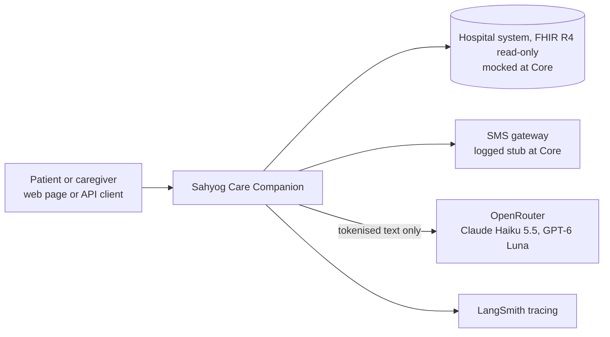
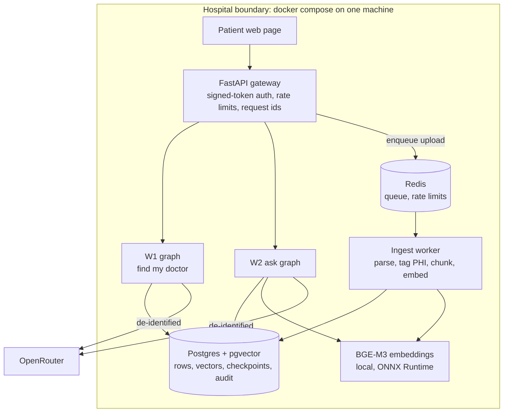
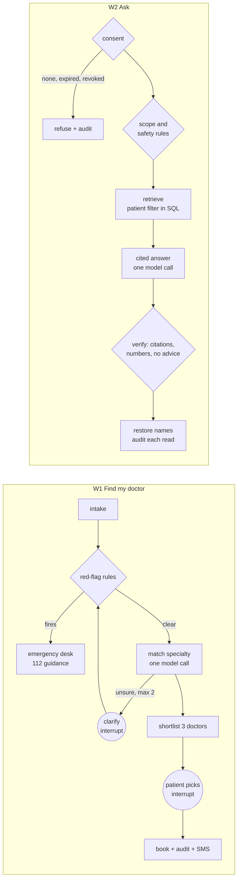

# Sahyog Care Companion

An agentic assistant for patients of Sahyog Health Network, a fictional hospital group in Pune and Hyderabad: find the right doctor and book without a phone call, and ask questions about your own medical reports with every answer cited. Built with LangGraph, FastAPI, Postgres + pgvector and Redis for the FDE Academy engagement pack.

**Tier reached:** Core · **Delivery:** solo · **Data:** synthetic only. No real patient data is used anywhere in this repository.

| Result on synthetic data | Figure |
|---|---|
| Simulated patients who booked without a call | 20 of 20 |
| Emergency (red-flag) recall | 100%, 0 false alarms |
| Specialty accuracy | 88% strict, 100% with the reviewed alternative |
| Answer faithfulness (calibrated judge) | 0.93 |
| Records leaked to the wrong patient | 0 |
| Model cost per consultation (one booking, one record question) | US$0.0008 |

Every figure comes from [`evals/report.md`](evals/report.md), which is generated from the run files.

---

## Contents

1. [The problem](#the-problem)
2. [What was built](#what-was-built)
3. [Architecture](#architecture)
4. [Privacy and safety by design](#privacy-and-safety-by-design)
5. [Getting started](#getting-started)
6. [Using the app](#using-the-app)
7. [API](#api)
8. [Evaluation](#evaluation)
9. [Decisions, discovery and documents](#decisions-discovery-and-documents)
10. [Limits and next steps](#limits-and-next-steps)
11. [Repository map](#repository-map)

---

## The problem

Sahyog Health Network runs 6 hospitals and 22 clinics. Patients phone the front desk to find out which doctor to see, wait on hold, and often land with the wrong specialist; reports sit in PDFs that patients cannot easily question. The client's mandate (engagement pack, page 4) is five outcomes:

1. A patient finds the right doctor and books in under three minutes without a phone call.
2. A patient sees and questions their own records, every answer cited and scoped to their own data.
3. A doctor leaves each consultation with a signed note after at most ninety seconds of review.
4. Every AI output is traceable, auditable and reversible by a named human.
5. The design runs under the DPDP Act and is ABDM-ready, with a path to on-premise handling of identified data.

**Constraints:** identified health data never leaves India; the model vendor must be swappable without a rewrite; the hospital system exposes FHIR R4 read-only; English first, with Hindi and Marathi later, so nothing may assume English; peak load is 1,400 requests an hour.

**Out of scope:** billing and insurance, telemedicine video and wearables, inpatient workflows.

This repository delivers the **Core tier**: outcomes 1, 2 and 4 for patients, with the platform for 5. Outcome 3, the doctor's scribe, is the Pro tier.

## What was built

| Workflow | What the patient does | How it works |
|---|---|---|
| **W1 Find my doctor** | Describes symptoms in English or Hindi-English, picks one of three doctors, gets a booking | Emergency rules run first and send red flags to a human; one model call matches a specialty against a reviewed condition-to-specialty crosswalk; up to two clarifying questions; the graph pauses (`interrupt()`) while the patient picks; booking is one idempotent transaction |
| **W2 My records** | Asks about their reports, or a parent's with consent; uploads a PDF | Consent check, then deterministic scope and safety rules, then retrieval filtered by patient in SQL, one cited answer and a verification step; uploads are ingested on a queue worker |
| **CR-001 My data** | Erases an uploaded report, gives or withdraws a family member's access | The self-set change request under the DPDP Act: erasure removes every derived copy; withdrawal takes effect on the next question |
| **Patient web page** | Uses all of the above in a browser at `localhost:8000` | One static page served by the API, no build step |

## Architecture

### Context



### Containers



### The graphs



Sequence diagrams: [W1 booking](docs/diagrams/w1-booking-sequence.md) · [W2 ask](docs/diagrams/w2-ask-sequence.md). The full architecture, with the 20 decisions and every correction made during the build, is in [`docs/architecture.md`](docs/architecture.md).

### Stack

| Layer | Choice | Version |
|---|---|---|
| Orchestration | LangGraph, Postgres checkpointer | 1.2.16, checkpoint-postgres 3.2.0 |
| API | FastAPI, Uvicorn | 0.162.0, 0.54.0 |
| Database | Postgres 18 with pgvector | image `pgvector/pgvector:0.8.7-pg18-trixie` |
| Queue | Redis, RQ | image `redis:8.10.2-alpine`, rq 2.12.0 |
| Models | OpenRouter: Claude Haiku 5.5 primary, GPT-6 Luna fallback and judge | chosen by measurement (ADR 0004) |
| Embeddings | BGE-M3, 1,024 dimensions, on ONNX Runtime | onnxruntime 1.31.0 (ADR 0005) |
| PHI detection | Presidio pattern recognisers, spaCy names on typed questions | presidio 2.2.364 (ADR 0006) |
| Evaluation | ragas Faithfulness on GPT-6 Luna, calibrated | ragas 0.4.3 (ADR 0007) |
| Tracing | LangSmith | 0.14.12 |

Exact pins are in [`pyproject.toml`](pyproject.toml).

## Privacy and safety by design

- **Identity comes from the token, never the text.** The API takes the patient id from a signed bearer token; request bodies reject unknown fields, so a body cannot carry one. A patient id typed into a question is refused.
- **The patient filter lives in the database query.** Search cannot run without a patient id, and it ranks exactly within that patient's rows.
- **Only tokenised text leaves.** Names, phone numbers, ABHA numbers, MRNs and patient ids become tokens like `<PERSON_1>` before any model call; the token map stays in Postgres and names are restored only for the entitled reader.
- **A report is data, never instructions.** Sentences in an upload that address the assistant are removed at ingest; the red-team PDF in the eval set proves it.
- **Rules before models.** Emergencies, consent, scope, and dose or diagnosis requests are decided by code; the model never clears a red flag.
- **Answers are verified, never repaired.** A citation to a report that was not retrieved, or a number absent from the excerpts, turns the answer into "not in the reports on file".
- **Every record read is audited** in an append-only table, with actor, purpose and the request id as trace id.
- **Erasure and consent withdrawal** under the DPDP Act (CR-001, ADR 0008).
- **Budget hard stop** at US$2.00 of model spend; every call is in [`data/llm_ledger.jsonl`](data/llm_ledger.jsonl).

## Getting started

**You need:** Docker Desktop, Python 3.12, an OpenRouter API key, and a Kaggle token for the public datasets. About 3 GB of disk for the embedding model.

### 1. Install and configure

```sh
git clone https://github.com/dhanushvaranasi-alpha/sahyog-hospital-problem.git && cd sahyog-hospital-problem
cp .env.example .env                 # add OPENROUTER_API_KEY and an AUTH_SIGNING_KEY; .env is git-ignored
python3.12 -m venv .venv && source .venv/bin/activate
pip install -e ".[dev]"
python -m spacy download en_core_web_lg
```

Generate a signing key with `python -c "import secrets; print(secrets.token_urlsafe(48))"`. Set `DEMO_MODE=true` in `.env` to enable the web page's demo sign-in.

### 2. Start the stack

```sh
docker compose -f infra/docker-compose.yml up -d --build    # Postgres, Redis, API on :8000, ingest worker
curl -s localhost:8000/health                               # {"status": "ok", ...}
```

### 3. Load the data

```sh
bash data/fetch_datasets.sh              # five public Kaggle datasets into data/raw/ (git-ignored)
python -m data.transforms.run            # clean each source into data/processed/, every dropped row tallied
python -m data.load                      # schema, reference data and history into Postgres
python -m data.synthetic.reports --render   # render the 100 synthetic report PDFs (text is committed)
python -m data.synthetic.load            # 500 doctors, 1,000 patients, slots, the persona consent
python -m services.records.ingest --synthetic   # index the reports (first run downloads BGE-M3)
```

The generated doctors and report texts are committed, so nothing above calls a model.

### 4. Open the app

Go to **http://localhost:8000**. The API reference is at http://localhost:8000/docs.

## Using the app

Pick who you are on the patient card; each person is a synthetic patient with a different story.

| Person | What to try |
|---|---|
| **Priya Deshmukh** | Book a dermatologist for a skin rash. Ask what her neck ultrasound recommended. Ask about her mother's echocardiogram (she has caregiver consent). Ask whether she can stop her seizure medicine: it goes to her doctor. |
| **Sunita Deshmukh** | Ask about her own creatinine. Try to read Priya's reports: refused, because consent runs one way. On *My data*, withdraw Priya's access and watch Priya's next question get refused. |
| **Lakshmi Mehta** | Upload `evals/sets/redteam/redteam_injection.pdf`, a report with hidden instructions to leak another patient's echo. Ask for a summary: only her own values come back. Then erase the upload on *My data*. |

The chest-pain example on *Find a doctor* shows an emergency: guidance to call 112 and an emergency-desk ticket, never a booking. The six-minute demo follows the same path: [`demo/script.md`](demo/script.md).

## API

All patient endpoints need `Authorization: Bearer <token>`. For development: `python -m services.api.auth --sub P-PRIYA`.

| Method and path | What it does |
|---|---|
| `POST /v1/w1/sessions` | Start finding a doctor; returns a clarifying question, slot options, or an emergency or front-desk hand-off |
| `POST /v1/w1/sessions/{id}/reply` | Answer the question, or pick a slot with an idempotency key; only the patient who started the session |
| `POST /v1/w2/questions` | Ask about your records, or a consenting relative's (`subject_patient_id`) |
| `POST /v1/w2/uploads` · `GET /v1/w2/uploads/{job_id}` | Upload a PDF (10 MB max) and follow its ingest; status shown only to the uploader |
| `GET /v1/w2/documents` · `DELETE /v1/w2/documents/{id}` | List your reports; erase an upload and every derived copy |
| `GET /v1/w2/consents` · `POST /v1/w2/consents` · `DELETE /v1/w2/consents/{grantee}` | See, give and withdraw caregiver access |
| `GET /v1/me` · `GET /health` | Who the token belongs to; Postgres and Redis reachability |

Rate limits per caller: 30 a minute for each workflow, 10 uploads a minute. `POST /demo/token` exists only when `DEMO_MODE=true` and only for the three synthetic personas.

## Evaluation

The eval sets were written before the graph code: 30 cases for W1 and 30 for W2, including a red-team PDF.

```sh
python -m pytest -q                                                     # about 165 tests
python -m evals.run_w1 --model anthropic/claude-haiku-5.5               # emergencies, specialty match, latency
python -m evals.run_w2 --model anthropic/claude-haiku-5.5 --judge openai/gpt-6-luna   # citations, leaks, faithfulness
python -m evals.run_sessions --model anthropic/claude-haiku-5.5         # 20 bookings end to end
python -m evals.build_report                                            # rewrite evals/report.md and docs/cost-sheet.md
```

A full set of runs costs about US$0.03. The faithfulness judge was calibrated on 20 answers before use, 6 of them deliberately altered; it agreed with the reference on 20 of 20 ([ADR 0007](docs/adr/0007-faithfulness-judge.md)). Details of every case and metric: [`evals/README.md`](evals/README.md). Cost per consultation, with the formula: [`docs/cost-sheet.md`](docs/cost-sheet.md).

## Decisions, discovery and documents

| Document | What it holds |
|---|---|
| [`docs/prd-lite.md`](docs/prd-lite.md) | Personas, journeys, epics and testable acceptance criteria |
| [`docs/rfp-response.md`](docs/rfp-response.md) | What was delivered against each client outcome |
| [`docs/task-cards.md`](docs/task-cards.md) | D1: 18 tasks on the automation ladder |
| [`docs/discovery-questions.md`](docs/discovery-questions.md) | D2: ten discovery questions and the decision each unlocks |
| [`docs/assumptions.md`](docs/assumptions.md) | D3: 15 assumptions, each with an owner, a validation and a fallback |
| [`docs/data-contracts/`](docs/data-contracts/) | D4: one contract per table, with its sensitivity class |
| [`docs/data-sizing.md`](docs/data-sizing.md) | D5: sizing and the three "is there enough data" checks |
| [`docs/change-requests/CR-001-dpdp-erasure.md`](docs/change-requests/CR-001-dpdp-erasure.md) | The self-set change request and its re-plan |
| [`docs/pre-mortem.md`](docs/pre-mortem.md) | Six ways the build could fail, and what the runs showed |
| [`memo/executive-memo.md`](memo/executive-memo.md) | One-page memo for the client |
| [`AI-COLLABORATION.md`](AI-COLLABORATION.md) | One entry per pull request: what the AI assistant proposed, what was rejected and why |

Architecture decision records in [`docs/adr/`](docs/adr/):

| ADR | Decision |
|---|---|
| 0001 | Model access through OpenRouter, so the vendor is a configuration change |
| 0002 | Report ingest on a Redis + RQ worker, never inside an HTTP request |
| 0003 | Local BGE-M3 embeddings: no egress, no cost, multilingual |
| 0004 | Claude Haiku 5.5 primary, GPT-6 Luna fallback, chosen on measured latency |
| 0005 | BGE-M3 on ONNX Runtime instead of PyTorch |
| 0006 | PHI tagging layers; name detection on typed questions only |
| 0007 | Faithfulness judge: ragas on GPT-6 Luna, calibrated on 20 answers |
| 0008 | CR-001: erasure removes every derived copy; audit rows and hospital records stay |

## Limits and next steps

- **Measured on synthetic data only.** The patient's own time to book needs usability sessions; availability and backup restore are not measured.
- **The model provider is not India-resident.** Only tokenised text leaves; moving identified-data processing on-premise is the documented path (ADR 0006).
- **Hospital-issued reports are not erasable through the assistant** (assumption A15, for the client's compliance officer).
- **Next:** confirm assumptions A03 and A15 with the client, then the Pro tier: the doctor's scribe with sign-off, 80 eval cases per workflow, and load testing at 1,400 requests an hour.

## Repository map

| Path | What it is |
|---|---|
| `services/agent/w1/` | W1 graph, red-flag rules, specialty match, doctor directory |
| `services/agent/w2/` | W2 ask graph, scope and safety rules, cited answer |
| `services/records/` | Parsing, PHI tags, injection filter, ingest graph and worker jobs, store, erasure |
| `services/common/` | Model client with budget stop and ledger, embeddings, PHI tokens |
| `services/api/` | FastAPI gateway, auth stub, rate limits, the patient web page (`static/`) |
| `data/` | Dataset download, transforms with tests, reference data, synthetic layer, loader, inventory |
| `evals/` | Eval sets, runners, judge and calibration, run files, report |
| `infra/` | docker compose and database schema |
| `docs/` | PRD, architecture, ADRs, discovery deliverables, contracts, diagrams, change request |
| `demo/` | Six-minute demo script |
| `memo/` | Executive memo |

## Data and licences

All patients, doctors, appointments and reports are synthetic or derived from five public Kaggle datasets; sources, row counts and licences are in [`data/inventory.md`](data/inventory.md). Fonts on the web page (Bitter, Atkinson Hyperlegible, IBM Plex Mono) are served locally under the SIL Open Font License. Not medical advice.
