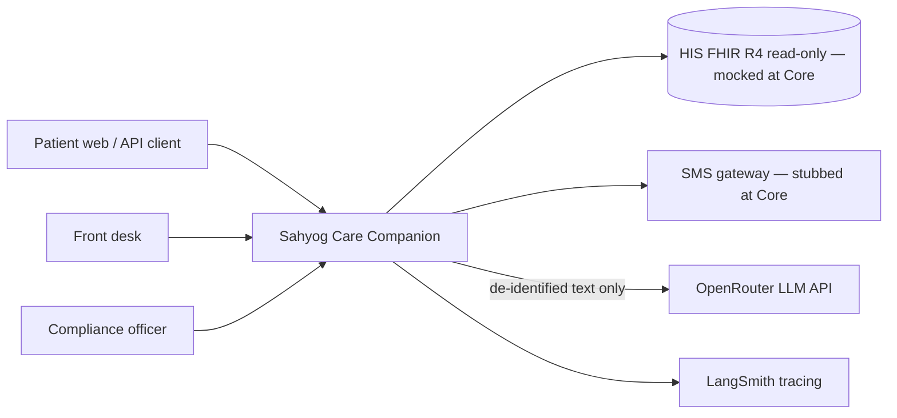
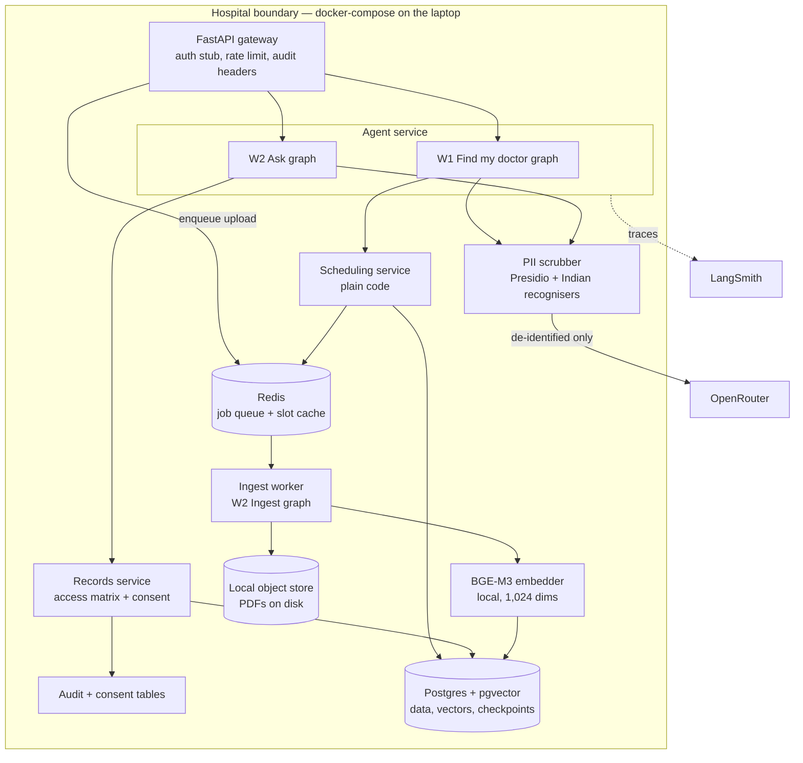
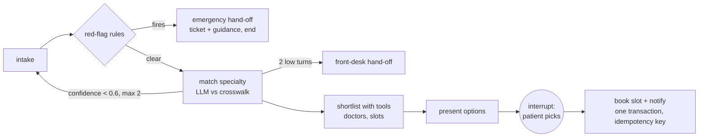
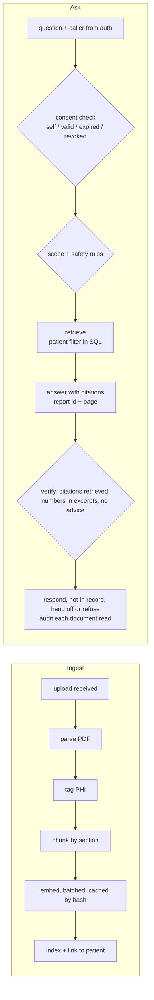

# Architecture v0.1: Sahyog Care Companion (Core tier)

Status: **Confirmed 24 Oct 2026**, except decision 6, which is settled by measurement (see the decision). Each row in section 4 becomes an ADR under `docs/adr/`.

This corrects the pack's target architecture (p23–p31) for a solo, Core-tier build on a laptop with an LLM budget of US$4. Where the build differs from the target, the difference and the reason are recorded in section 5.

## 1. Context

Doctor console, speech-to-text and the pharmacy feed join at Pro tier (W3).

## 2. Containers (Core)

Only the three graphs call a model; everything else is plain code. Only the scrubber's output crosses the boundary.

## 3. Graphs

### W1 Find my doctor

State: messages, symptoms, age, red_flags, specialty, confidence, candidates, chosen_slot, booking_id, audit_ids.

### W2 Ingest (queue worker) and Ask (interactive)

As built (PR #7): the "grade context, retrieve again once" loop of v0.1 was left out. Retrieval put the expected report in the top 8 for 13 of 13 answerable W2 cases, so a second retrieval would add a model call without a measured gain; the verify step rejects answers the excerpts do not support instead. Revisit if retrieval recall drops below 100% on the set.

## 4. Decisions

Versions checked on PyPI / Hugging Face / OpenRouter on 24 Oct 2026. Rows 16–20 were added when the decisions were confirmed.

| # | Decision | Choice | Why | Revisit when |
|---|---|---|---|---|
| 1 | Orchestration | LangGraph **1.2.16** | Interrupts, checkpoints, replay (p51). 1.2.17 was released on 24 Oct 2026; not pinned until checked. A 5-minute interrupt/resume repro confirms 1.2.16 before W1 is built (p39) | A repro shows a bug fixed in a later patch |
| 2 | Durable state | langgraph-checkpoint-postgres **3.2.0** | Runs survive restarts; API stays stateless (p29) | — |
| 3 | API | FastAPI **0.162.0**, one router per workflow | Pack stack; workflows scale apart later (p24) | — |
| 4 | Database | Postgres + pgvector in docker-compose | One store for rows, vectors and checkpoints; patient filter and similarity search in one SQL query | Vectors outgrow one node |
| 5 | LLM access | **OpenRouter** behind one `ModelClient` interface (OpenAI-compatible) | Vendor swappable by config (p4 constraint); one key, US$4 budget | Budget or residency terms change |
| 6 | Primary model | **`anthropic/claude-haiku-5.5`**, chosen by measurement (ADR 0004): p95 2.9–3.2 s in 3 runs against 3.4–4.4 s for GPT-6 Luna; strict accuracy 88.2% vs 94.1%, both 100% red-flag recall | Both meet the accuracy target; only Haiku meets the 4 s latency target reliably | Strict accuracy below 85% or p95 above 3.5 s |
| 7 | Fallback model | `openai/gpt-6-luna` — different provider | A fallback that is configured and tested, not just named (p36); it ran the full W1 set four times | — |
| 8 | Embeddings | **BGE-M3** local (BAAI, MIT licence, 1,024 dimensions, 2.27 GB download) | Matches the pack's 1,024-dim sizing; multilingual for Hindi/Marathi later; costs nothing against the budget; report text never leaves the laptop for embedding. Runs on ONNX Runtime, not PyTorch (ADR 0005) | Ingest too slow on CPU |
| 9 | PII detection | presidio-analyzer / presidio-anonymizer **2.2.364** + custom Indian phone and ABHA recognisers | Pack's choice (p21); token map kept locally. Name NER runs on typed questions only (ADR 0006) | — |
| 10 | Tracing | **LangSmith** (langsmith 0.14.12) | Native LangGraph integration, set up with environment variables; all data is synthetic, so a hosted tracer is acceptable here | Real identified data enters: tracing must move in-region or self-hosted |
| 11 | Ingest execution | **Redis + RQ worker** (redis 8.1.0, rq 2.12.0); upload returns a job id; status endpoint reads the job | Never hold an HTTP connection open for a PDF (p36); a real queue matches the pack's container view (p23) and lets ingest scale apart from the API | Ingest volume needs parallel workers (Architect: Send API) |
| 12 | Auth | Signed token stub carrying role, user_id, patient_id into graph state | Tools never trust a patient_id the model typed (p36); OIDC + OTP deferred | Pro/Architect |
| 13 | External systems | SMS = logged stub; FHIR = mock served from the Healthcare dataset | FHIR is optional in the pack; keeps the build offline-capable | A sandbox is provided |
| 14 | PDF parsing | pypdf **6.21.2**; OCR fallback deferred | Synthetic PDFs are text PDFs | Scanned PDFs enter the set |
| 15 | Budget guard | Cost meter per run, **hard stop at US$2.00** cumulative spend | Core is estimated at about US$0.75 (section 6): room to redo every LLM step more than twice, with half the key kept for Pro work | Pro work starts |
| 16 | Slot cache | Redis, 30-second TTL | Redis is already running for the queue, so the cache matches the pack (p31) at no extra cost | — |
| 17 | Eval sets | **30 cases per workflow** (W1 30, W2 30), written before graph code | The pack says 30 on p40 and 30 per workflow on p45; 60 satisfies both readings | Pro: 80 per workflow |
| 18 | Faithfulness judge | LLM judge with ragas **0.4.3**, calibrated against 20 hand-graded answers before use; never the only release gate | Meets the p16 target as written (≥ 0.9 by a calibrated judge) and the p46 method | Judge and hand grades disagree on more than 2 of 20 |
| 19 | Synthetic reports | **100** report PDFs from LLM-written text seeded by the transcriptions | About two per test patient; enough for at least 5 candidate chunks per W2 eval case (D5) | A W2 case has fewer than 5 candidate chunks |
| 20 | Change request | No change request will be issued, so a realistic one is **self-set**, labelled "self-set, not issued by the client", and run through the two-hour re-plan with an ADR (p43) | The review scores the re-plan ritual and the ADR, not whether the change was built (p43) | The client issues a real one |

## 5. Differences from the pack's target architecture

| Pack target | This build | Reason |
|---|---|---|
| OIDC with OTP (p33) | Signed token stub | Identity provider out of scope for a Core build |
| Object store (p23) | Local folder | No audio at Core; PDFs only |
| Scribe service, STT, stock feed | Not built | W3 is Pro tier |
| Langfuse or LangSmith (p47) | LangSmith | Chosen for native LangGraph integration |
| Client answers to the D2 questions (p9) | Working assumptions, each logged in D3 with a validation and a fallback | No client answers available |

## 6. LLM budget estimate (Core)

Prices from OpenRouter on 24 Oct 2026; both candidate models cost US$0.10 / 1M input and US$0.50 / 1M output. Token counts are starting assumptions; traces replace them.

| Activity | Calls | Input tokens | Output tokens | Est. cost (US$) |
|---|---|---|---|---|
| Synthetic doctor directory | 10 | 15,000 | 60,000 | 0.03 |
| Synthetic report PDF text (100) | 100 | 100,000 | 150,000 | 0.09 |
| Condition-to-specialty crosswalk draft | 1 | 2,000 | 4,000 | < 0.01 |
| Triage turns during development | 300 | 450,000 | 90,000 | 0.09 |
| Record answers during development | 150 | 600,000 | 60,000 | 0.09 |
| Eval runs (5 runs × 60 cases × 3 calls) | 900 | 2,250,000 | 270,000 | 0.36 |
| Judge (5 runs × 30 W2 cases + 20 calibration) | 170 | 510,000 | 34,000 | 0.07 |
| Model comparison (W1 set on the second model) | 60 | 150,000 | 18,000 | 0.02 |
| **Total** | | **4,077,000** | **686,000** | **≈ 0.75** |

Cost formula per line: `calls × (input × p_in + output × p_out)`, with p_in = US$0.10 / 1M and p_out = US$0.50 / 1M.
