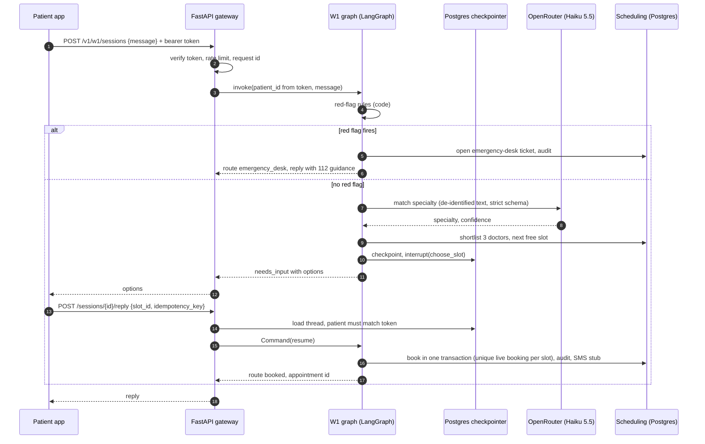

# Sequence: a patient books a doctor (W1)

Low confidence takes a clarify interrupt (at most two) before the shortlist; a model failure or two unclear turns goes to the front desk. A slot taken between offer and pick returns a fresh shortlist.
