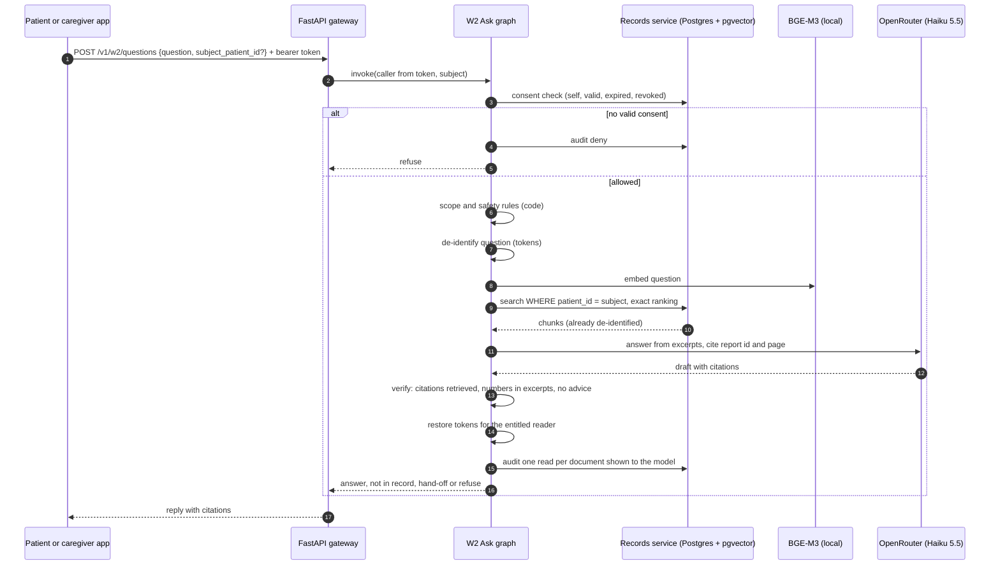

# Sequence: a patient asks about a report (W2)

Uploads take a separate path: `POST /v1/w2/uploads` stores the PDF and returns a job id; the RQ worker parses it, tags PHI, removes instruction sentences, chunks, embeds and indexes it.
